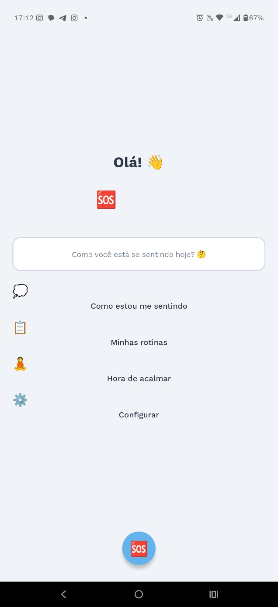
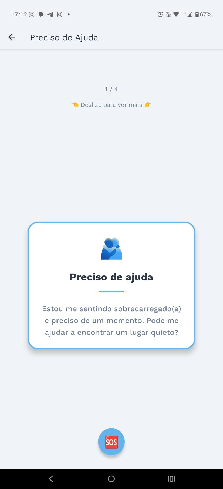

# TEA Kids

**Rotinas visuais e comunicação de ajuda para crianças e adolescentes.**

`React Native · Expo · TypeScript`

[Reportar problema](https://github.com/alunoadsnoite/tea-mvp-childs/issues) · [Licença](LICENSE)


## Veja o aplicativo





Aplicativo móvel para crianças e adolescentes no Espectro Autista (TEA) focado em **autonomia, previsibilidade e regulação emocional**.

## Versão 1.1.14

[Histórico completo de versões](CHANGELOG.md).

## Principais Funcionalidades

Em **Configurações → Idioma**, escolha **Português (Brasil)**, **English** ou **Español**. A preferência fica salva no aparelho e funciona offline. Os textos personalizados são preservados. O endereço em **Desenvolvedor** abre o aplicativo de e-mail.

### 1. Cartão de Comunicação de Ajuda
- Acesso instantâneo em 1 toque na Home ou pelo botão flutuante
- Mensagens pré-configuradas com emojis
- Contatos de emergência (ligar/mensagem)
- Funcionalidade 100% offline
- Linguagem adaptada para crianças

### 2. Check-in de Emoções
- Registro rápido com emojis (😞 😕 😐 🙂 😄)
- Felicidade, Energia e Calma
- Gatilhos com emojis (Escola, Amigos, Família, etc.)
- Sugestões automáticas de regulação
- Histórico dos últimos 7 dias

### 3. Rotinas Visuais Sequenciais
- Execução passo-a-passo (uma tarefa por vez)
- Timer visual suave (sem números estressantes)
- Rotinas pré-configuradas (Manhã, Lição, Dormir, Brincar)
- Emojis em cada passo
- Pausa e extensão de tempo sem penalidade

### 4. Central de Cartões de Calma
- Exercícios de respiração divertidos (Balão, Coelho, Flor)
- Jogo dos 5 Sentidos
- Alongamento de Gato
- Desenho da Calma
- Pulo de Energia
- Favoritos e categorias

## Stack Tecnológica

- **Frontend**: React Native + Expo SDK 50 + TypeScript
- **Estilização**: StyleSheet (padrão do projeto original)
- **Estado**: Zustand + AsyncStorage (offline-first)
- **Navegação**: Expo Router
- **Build**: EAS Build / Gradle

## Instalação

```bash
# Instalar dependências
npm install

# Iniciar em modo desenvolvimento
npx expo start

# Build Android (APK)
npx eas build -p android --profile preview

# Build local
npx expo prebuild -p android          # gera android/ (managed workflow)
JAVA_HOME=/caminho/para/jdk17 ./android/gradlew assembleRelease
```

O projeto usa Expo com geração do projeto nativo. Apenas `android/app/.gitkeep` é rastreado para preparar o subdiretório utilizado pelo F-Droid. Gere o projeto Android com `npx expo prebuild -p android` antes de executar o Gradle.

Para instalar no aparelho use `assembleRelease`. O APK **debug** não embute o
bundle JS e depende do Metro rodando em `localhost:8081` — instalado sozinho,
abre uma tela de erro.

> **Atenção: JDK 17 é obrigatório.** O AGP 8.1.1 do SDK 50 falha com JDK 21.

O widget "Preciso de ajuda" está **implementado no Android** (um toque abre
`/crisis-card`) e **não implementado no iOS** — ver
[WIDGET_SETUP.md](WIDGET_SETUP.md). Sem o widget, o cartão de ajuda continua
acessível pelo botão flutuante 🆘 e pelo card da Home.

## Estrutura do projeto

- `app/`: telas e rotas do Expo Router, incluindo o layout e o cartão de ajuda.
- `src/`: componentes, stores, tipos e hooks compartilhados.
- `widget/android/`: fontes do widget Android.
- `plugins/`: configuração nativa aplicada pelo Expo.
- `fastlane/` e `fdroid/`: metadados e preparação da distribuição.

## Princípios de UX Neurodivergente (Kids)

- **Tema claro por padrão**: Mais adequado para crianças
- **Emojis em tudo**: Facilita a compreensão
- **Linguagem simples**: Palavras curtas e frases diretas
- **Cores vibrantes mas suaves**: Azul, verde, amarelo
- **Baixa carga cognitiva**: Uma ação principal por tela
- **Sem animações piscantes**: Apenas transições suaves
- **Sem alertas vermelhos**: Notificações discretas
- **Tipografia legível**: Contraste WCAG AA
- **Espaçamento generoso**: Respiro visual

## Diferenças do MVP Adultos

| Aspecto | Adultos | Crianças/Adolescentes |
|---------|---------|----------------------|
| Tema padrão | Escuro | Claro |
| Linguagem | Formal | Simples e divertida |
| Check-in | Números (0-100%) | Emojis (😞 😕 😐 🙂 😄) |
| Gatilhos | Texto | Emojis + texto |
| Rotinas | Trabalho/Adulto | Escola/Casa/Brincar |
| Respiração | 4-4-4-4, 4-7-8 | Balão, Coelho, Flor |
| Cartões | Ancoragem 5-4-3-2-1 | Jogo dos 5 Sentidos |
| Cores | Pastel suave | Vibrantes mas suaves |

## F-Droid

Preparação e instruções de compilação: [FDROID.md](FDROID.md). Acompanhe a atualização no [catálogo do F-Droid](https://f-droid.org/packages/com.teakids.app/).

## Licença

[MIT](LICENSE)


## Privacidade

O diário, as rotinas, os cartões, os contatos de apoio e as preferências são guardados no aparelho. O desenvolvedor não recebe esses registros pelo app. Em **Meu Diário → Apagar meu diário**, é possível excluir todos os registros de emoções, inclusive os mais antigos. Rotinas, cartões, contatos e preferências permanecem no aparelho. Os contatos podem ser removidos nas configurações do Cartão de Ajuda. Para apagar todos os dados locais, limpe o armazenamento do app nos ajustes do Android.

Ao preparar um SMS, o app de mensagens recebe o número do contato e o texto do cartão. A pessoa escolhe se quer enviar. SMS e rascunhos mantidos pelo app de mensagens são gerenciados lá. Crianças e adolescentes podem pedir ajuda a um adulto de confiança. Contato para dúvidas sobre privacidade: valdenorsa@proton.me.

Em **Configurações → Para responsáveis**, há um atalho para os ajustes do TEA Kids no Android e orientações para acompanhar e limitar o tempo de uso com o Family Link em aparelhos supervisionados. Um limite aplicado pelo Android pode afetar o acesso ao Cartão de Ajuda.

## Como contribuir

Sugestões, traduções e relatos de problemas são bem-vindos. Abra uma issue com o contexto e o comportamento esperado. Para alterações de código, explique a mudança e os testes realizados no pull request. Use dados fictícios nos exemplos e nas capturas.

### Idiomas

Em **Configurações → Idioma**, escolha Português (Brasil), English, Español ou Français. A escolha fica salva no aparelho. Os conteúdos padrão são traduzidos; os textos personalizados são preservados. O widget acompanha o idioma do Android.
